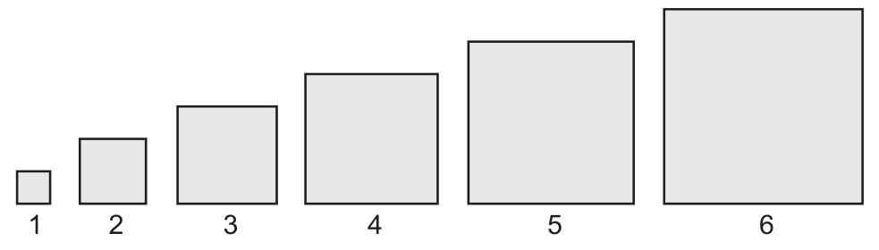

<Accordion titulo="Palavras e siglas desta aula" dica="Consulte quando encontrar um termo novo" icone="spell-check">

- **ENEM** (Exame Nacional do Ensino Médio): a prova nacional que dá acesso a faculdades e bolsas.
- **INEP** (Instituto Nacional de Estudos e Pesquisas Educacionais Anísio Teixeira): o órgão do governo que faz o ENEM.
- **PA** (progressão aritmética): sequência em que se soma sempre o mesmo número para ir de um termo ao seguinte.
- **Subsequentes**: os que vêm depois.
- **Projeção**: estimativa do que vai acontecer no futuro.
- **Números figurados**: números que podem ser desenhados como pontos formando uma figura (triângulo, quadrado, pentágono).
- **Pitagóricos**: seguidores de Pitágoras, filósofo e matemático grego da Antiguidade.
- **Excede**: passa de, é maior que.
- **Meta**: o objetivo que se quer alcançar.
- **a.C.** (antes de Cristo): forma de contar os anos antes do ano 1 do calendário cristão. O século V a.C. vai do ano 500 ao 401 antes de Cristo.

</Accordion>

## Antes de Começar

**O que o ENEM cobra aqui.** A prova descreve algo que aumenta ou diminui sempre do mesmo jeito e pergunta sobre um ponto distante dessa sequência. O segredo é reconhecer a razão e a posição do termo pedido. Os temas que costumam aparecer são estes:

- **Achar um termo distante** sem escrever a sequência inteira.
- **Somar muitos termos** de uma PA.
- **Descobrir quantos termos** são precisos para atingir uma meta.
- **Continuar uma sequência desenhada** usando a tabela de diferenças.
- **Calcular a diferença entre termos vizinhos** a partir de uma fórmula com n.

**O que você precisa saber antes.**

- **Contar posições.** De 2003 até 2008 são 2008 − 2003 + 1 = 6 anos: os dois extremos entram. Esse "+ 1" está explicado na aula de Divisibilidade e Fatoração.
- **Potências.** n² = n × n. Revise a aula de Potências e Raízes.
- **Área do quadrado.** Área = lado × lado = lado². Um quadrado de lado 5 cm tem 5² = 25 cm² de área.
- **Distributiva.** 3 × (n − 1) = 3n − 3; −(n − 4) = −n + 4 (o sinal de menos troca o sinal de cada parcela de dentro).
- **Decimais.** 7 × 1,5 = 10,5; somar e multiplicar decimais sem perder a vírgula.

## Aula Teórica

### 1. Sequências e a notação aₙ

Uma **sequência** é uma lista de números em ordem: o primeiro, o segundo, o terceiro… Cada número da lista é um **termo**.

Para falar de um termo sem escrever o número, usamos uma letra com um número pequeno embaixo, o **índice**, que diz a posição. a₁ (lê-se "a um") é o primeiro termo, a₂ é o segundo, e aₙ (lê-se "a n") é o termo da posição n, qualquer que ela seja.

O termo **anterior** ao aₙ é o aₙ₋₁ (lê-se "a n menos um"): a posição dele é uma antes. Se n = 5, aₙ é o a₅ e aₙ₋₁ é o a₄.

**Erro comum.** Confundir a posição com o valor. Em 10, 20, 30, 40, o a₃ é 30: o 3 é a posição, e o 30 é o valor.

### 2. O que é uma PA

Numa PA (progressão aritmética), passa-se de um termo ao seguinte somando sempre o mesmo número. Esse número é a **razão**, chamada r.

Pense nas fileiras de um teatro. A 1ª tem 18 cadeiras, e cada fileira seguinte tem 2 a mais: 18, 20, 22, 24, 26… É uma PA de razão 2. Veja como degraus de mesma altura no desenho abaixo.

<figure class="figura">
  <svg viewBox="0 0 460 196" role="img" aria-labelledby="fig-pa-1-t fig-pa-1-d">
    <title id="fig-pa-1-t">Uma PA como degraus de mesma altura</title>
    <desc id="fig-pa-1-d">Cinco barras lado a lado, com os valores 18, 20, 22, 24 e 26, marcadas a₁ a a₅. Entre uma barra e a seguinte está escrito +2: cada termo é o anterior mais a razão r = 2, como degraus de mesma altura.</desc>
    <rect x="40" y="118" width="70" height="32" class="traco preenche" />
    <text x="75.0" y="136" class="rotulo" text-anchor="middle">18</text>
    <text x="75.0" y="166" class="rotulo-fraco" text-anchor="middle">a₁</text>
    <rect x="122" y="110" width="70" height="40" class="traco preenche" />
    <text x="157.0" y="128" class="rotulo" text-anchor="middle">20</text>
    <text x="157.0" y="166" class="rotulo-fraco" text-anchor="middle">a₂</text>
    <text x="116" y="102" class="rotulo-fraco" text-anchor="middle">+2</text>
    <rect x="204" y="102" width="70" height="48" class="traco preenche" />
    <text x="239.0" y="120" class="rotulo" text-anchor="middle">22</text>
    <text x="239.0" y="166" class="rotulo-fraco" text-anchor="middle">a₃</text>
    <text x="198" y="94" class="rotulo-fraco" text-anchor="middle">+2</text>
    <rect x="286" y="94" width="70" height="56" class="traco preenche" />
    <text x="321.0" y="112" class="rotulo" text-anchor="middle">24</text>
    <text x="321.0" y="166" class="rotulo-fraco" text-anchor="middle">a₄</text>
    <text x="280" y="86" class="rotulo-fraco" text-anchor="middle">+2</text>
    <rect x="368" y="86" width="70" height="64" class="traco preenche" />
    <text x="403.0" y="104" class="rotulo" text-anchor="middle">26</text>
    <text x="403.0" y="166" class="rotulo-fraco" text-anchor="middle">a₅</text>
    <text x="362" y="78" class="rotulo-fraco" text-anchor="middle">+2</text>
    <text x="230" y="186" class="rotulo" text-anchor="middle">cada termo = anterior + r, com r = 2</text>
  </svg>
</figure>

Para ter certeza de que a sequência é uma PA, confira se a diferença entre vizinhos é igual em todos os pares.

**Fórmula: razão da PA**

**r = termo seguinte − termo anterior**

- **r**: a razão, o valor somado a cada passo.
- **termo seguinte**: qualquer termo a partir do segundo (por exemplo, a₂).
- **termo anterior**: o termo logo antes dele (por exemplo, a₁). Assim, r = a₂ − a₁.
- **Em palavras:** quanto a sequência anda de um termo para o próximo.
- **Quando usar:** para achar a razão a partir de dois termos vizinhos e para conferir se uma sequência é uma PA.

**Exemplo resolvido.** A sequência 7, 11, 15, 19 é uma PA? Qual é a razão?

1. Diferenças: 11 − 7 = 4; 15 − 11 = 4; 19 − 15 = 4.
2. Todas iguais: é uma PA.
3. Resposta: r = 4.

- Se r é positivo, a PA **cresce** (18, 20, 22…).
- Se r é negativo, a PA **diminui** (50, 47, 44…: r = −3).
- Se r é zero, todos os termos são iguais.

**Erro comum.** Calcular a razão ao contrário (a₁ − a₂) e trocar o sinal. Sempre: termo seguinte menos termo anterior.

### 3. Termo geral

Para chegar à fileira 12 do teatro, não é preciso escrever as 12. Da 1ª à 12ª, a razão é somada 11 vezes: uma vez a menos que a posição.

**Fórmula: termo geral da PA**

**aₙ = a₁ + (n − 1) × r**

- **aₙ**: o termo da posição n, o valor que queremos.
- **a₁**: o primeiro termo.
- **n**: a posição do termo (1, 2, 3…).
- **r**: a razão, o valor somado a cada passo.
- **Em palavras:** comece no primeiro termo e some a razão (n − 1) vezes.
- **Quando usar:** para achar um termo distante, ou para achar a₁, r ou n quando os outros valores são conhecidos.

**Exemplo resolvido.** No teatro, a 1ª fileira tem 18 cadeiras e cada fileira seguinte tem 2 a mais. Quantas cadeiras tem a 12ª fileira?

1. Dados: a₁ = 18, r = 2, n = 12.
2. Fórmula: a₁₂ = 18 + (12 − 1) × 2.
3. Calcular: 18 + 11 × 2 = 18 + 22 = 40.
4. Resposta: 40 cadeiras.

A mesma fórmula funciona ao contrário. Se o 8º termo de uma PA de razão 3 é 40, então 40 = a₁ + 7 × 3 = a₁ + 21, e a₁ = 19.

Quando a sequência anda pelos meses, dias ou anos, troque cada um pela posição. Se a contagem começa em janeiro, março é o termo 3 e setembro é o termo 9.

**Erro comum.** Somar a razão n vezes em vez de (n − 1). Na 12ª fileira, isso daria 18 + 24 = 42, e não 40.

### 4. Soma dos termos

Conta-se que o matemático Gauss, ainda criança, somou de 1 a 100 em segundos. Ele percebeu que o primeiro mais o último dá o mesmo que o segundo mais o penúltimo, e assim por diante. Veja a ideia com os números de 1 a 10 no esquema abaixo.

<figure class="figura">
  <svg viewBox="0 0 460 184" role="img" aria-labelledby="fig-pa-2-t fig-pa-2-d">
    <title id="fig-pa-2-t">Soma de 1 a 10 por pares</title>
    <desc id="fig-pa-2-d">Na linha de cima, os números de 1 a 10. Na linha de baixo, os mesmos números ao contrário, de 10 a 1. Cada coluna soma 11. Como são 10 colunas e cada número foi escrito duas vezes, 2 × soma = 10 × 11, e a soma é 10 × 11 ÷ 2 = 55.</desc>
    <text x="40" y="40" class="rotulo" text-anchor="middle">1</text>
    <text x="40" y="110" class="rotulo" text-anchor="middle">10</text>
    <line x1="40" y1="48" x2="40" y2="94" class="tracejado" />
    <text x="40" y="136" class="rotulo-fraco" text-anchor="middle">11</text>
    <text x="80" y="40" class="rotulo" text-anchor="middle">2</text>
    <text x="80" y="110" class="rotulo" text-anchor="middle">9</text>
    <line x1="80" y1="48" x2="80" y2="94" class="tracejado" />
    <text x="80" y="136" class="rotulo-fraco" text-anchor="middle">11</text>
    <text x="120" y="40" class="rotulo" text-anchor="middle">3</text>
    <text x="120" y="110" class="rotulo" text-anchor="middle">8</text>
    <line x1="120" y1="48" x2="120" y2="94" class="tracejado" />
    <text x="120" y="136" class="rotulo-fraco" text-anchor="middle">11</text>
    <text x="160" y="40" class="rotulo" text-anchor="middle">4</text>
    <text x="160" y="110" class="rotulo" text-anchor="middle">7</text>
    <line x1="160" y1="48" x2="160" y2="94" class="tracejado" />
    <text x="160" y="136" class="rotulo-fraco" text-anchor="middle">11</text>
    <text x="200" y="40" class="rotulo" text-anchor="middle">5</text>
    <text x="200" y="110" class="rotulo" text-anchor="middle">6</text>
    <line x1="200" y1="48" x2="200" y2="94" class="tracejado" />
    <text x="200" y="136" class="rotulo-fraco" text-anchor="middle">11</text>
    <text x="240" y="40" class="rotulo" text-anchor="middle">6</text>
    <text x="240" y="110" class="rotulo" text-anchor="middle">5</text>
    <line x1="240" y1="48" x2="240" y2="94" class="tracejado" />
    <text x="240" y="136" class="rotulo-fraco" text-anchor="middle">11</text>
    <text x="280" y="40" class="rotulo" text-anchor="middle">7</text>
    <text x="280" y="110" class="rotulo" text-anchor="middle">4</text>
    <line x1="280" y1="48" x2="280" y2="94" class="tracejado" />
    <text x="280" y="136" class="rotulo-fraco" text-anchor="middle">11</text>
    <text x="320" y="40" class="rotulo" text-anchor="middle">8</text>
    <text x="320" y="110" class="rotulo" text-anchor="middle">3</text>
    <line x1="320" y1="48" x2="320" y2="94" class="tracejado" />
    <text x="320" y="136" class="rotulo-fraco" text-anchor="middle">11</text>
    <text x="360" y="40" class="rotulo" text-anchor="middle">9</text>
    <text x="360" y="110" class="rotulo" text-anchor="middle">2</text>
    <line x1="360" y1="48" x2="360" y2="94" class="tracejado" />
    <text x="360" y="136" class="rotulo-fraco" text-anchor="middle">11</text>
    <text x="400" y="40" class="rotulo" text-anchor="middle">10</text>
    <text x="400" y="110" class="rotulo" text-anchor="middle">1</text>
    <line x1="400" y1="48" x2="400" y2="94" class="tracejado" />
    <text x="400" y="136" class="rotulo-fraco" text-anchor="middle">11</text>
    <text x="230" y="170" class="rotulo" text-anchor="middle">2 × soma = 10 × 11, então soma = 10 × 11 ÷ 2 = 55</text>
  </svg>
</figure>

**Fórmula: soma dos n primeiros termos da PA**

**Sₙ = (a₁ + aₙ) × n ÷ 2**

- **Sₙ**: a soma dos n primeiros termos.
- **a₁**: o primeiro termo.
- **aₙ**: o último termo somado (o de posição n).
- **n**: quantos termos estão sendo somados.
- **Em palavras:** some o primeiro com o último, multiplique pela quantidade de termos e divida por 2.
- **Quando usar:** para o total de uma PA: total de cadeiras, de produção, de pontos ao longo de vários períodos.

**Exemplo resolvido.** Quantas cadeiras há nas 12 fileiras do teatro?

1. Dados: a₁ = 18, a₁₂ = 40 (achado na seção anterior), n = 12.
2. Fórmula: S₁₂ = (18 + 40) × 12 ÷ 2.
3. Calcular: 58 × 12 = 696; 696 ÷ 2 = 348.
4. Resposta: 348 cadeiras.

Se o último termo não foi dado, ache-o antes com o termo geral. E conte bem quantos termos entram: da semana 3 à semana 15, são 15 − 3 + 1 = 13 semanas.

**Erro comum.** Esquecer de dividir por 2, ou usar como "último termo" um valor que não é o da posição n.

### 5. Quantos termos para chegar a uma meta

Às vezes a pergunta é ao contrário: quantos termos são precisos para a soma chegar a um valor. Escreva Sₙ com n como letra e teste valores de n.

Metas costumam vir com "pelo menos", que se escreve com o símbolo ≥ (lê-se "maior ou igual a"): Sₙ ≥ 100 quer dizer que a soma é 100 ou mais. O símbolo também aparece em condições como n ≥ 2, que quer dizer "n vale 2 ou mais".

**Exemplo resolvido.** Numa pilha de latas, a camada de cima tem 3 latas, e cada camada de baixo tem 2 latas a mais que a de cima dela. Quantas camadas são precisas para a pilha ter pelo menos 100 latas?

1. Dados: a₁ = 3, r = 2. Termo geral: aₙ = 3 + (n − 1) × 2 = 2n + 1.
2. Soma: Sₙ = (3 + 2n + 1) × n ÷ 2 = (2n + 4) × n ÷ 2 = (n + 2) × n.
3. Queremos Sₙ ≥ 100. Testar n = 9: 11 × 9 = 99. Ainda não chega.
4. Testar n = 10: 12 × 10 = 120. Passa de 100.
5. Resposta: 10 camadas.

Leia com atenção o que a pergunta quer: o **total** de termos, o **valor** do último termo ou quantos termos **ainda faltam** a partir de um certo ponto. São três respostas diferentes. Se já foram contadas 7 camadas dessa pilha, ainda faltam 10 − 7 = 3; a 10ª camada tem a₁₀ = 2 × 10 + 1 = 21 latas.

**Erro comum.** Parar no primeiro n testado que chega perto da meta, sem conferir se ele já atinge o valor pedido ("pelo menos" inclui o igual).

### 6. Quando as diferenças formam uma PA

Algumas sequências não são PA, mas têm uma regra escondida nas diferenças. Monte a **tabela de diferenças**: escreva a sequência e, embaixo, a diferença entre cada termo e o anterior.

Na sequência 2, 5, 10, 17, 26, as diferenças são 3, 5, 7, 9. Elas formam uma PA de razão 2. Então as próximas diferenças são 11 e 13, e os próximos termos são 26 + 11 = 37 e 37 + 13 = 50.

<figure class="figura">
  <svg viewBox="0 0 460 172" role="img" aria-labelledby="fig-pa-3-t fig-pa-3-d">
    <title id="fig-pa-3-t">Tabela de diferenças de uma sequência</title>
    <desc id="fig-pa-3-d">Na linha de cima, a sequência 2, 5, 10, 17, 26 e, em cinza, os próximos termos 37 e 50. Na linha do meio, a diferença entre cada termo e o anterior: 3, 5, 7, 9 e, em cinza, 11 e 13. Na linha de baixo, entre as diferenças, +2: as diferenças formam uma PA de razão 2.</desc>
    <text x="40" y="40" class="rotulo" text-anchor="middle">2</text>
    <text x="104" y="40" class="rotulo" text-anchor="middle">5</text>
    <line x1="48" y1="48" x2="72.0" y2="64" class="traco-fino" />
    <line x1="96" y1="48" x2="72.0" y2="64" class="traco-fino" />
    <text x="72.0" y="80" class="rotulo" text-anchor="middle">3</text>
    <text x="168" y="40" class="rotulo" text-anchor="middle">10</text>
    <line x1="112" y1="48" x2="136.0" y2="64" class="traco-fino" />
    <line x1="160" y1="48" x2="136.0" y2="64" class="traco-fino" />
    <text x="136.0" y="80" class="rotulo" text-anchor="middle">5</text>
    <text x="104.0" y="108" class="rotulo-fraco" text-anchor="middle">+2</text>
    <text x="232" y="40" class="rotulo" text-anchor="middle">17</text>
    <line x1="176" y1="48" x2="200.0" y2="64" class="traco-fino" />
    <line x1="224" y1="48" x2="200.0" y2="64" class="traco-fino" />
    <text x="200.0" y="80" class="rotulo" text-anchor="middle">7</text>
    <text x="168.0" y="108" class="rotulo-fraco" text-anchor="middle">+2</text>
    <text x="296" y="40" class="rotulo" text-anchor="middle">26</text>
    <line x1="240" y1="48" x2="264.0" y2="64" class="traco-fino" />
    <line x1="288" y1="48" x2="264.0" y2="64" class="traco-fino" />
    <text x="264.0" y="80" class="rotulo" text-anchor="middle">9</text>
    <text x="232.0" y="108" class="rotulo-fraco" text-anchor="middle">+2</text>
    <text x="360" y="40" class="rotulo-fraco" text-anchor="middle">37</text>
    <line x1="304" y1="48" x2="328.0" y2="64" class="traco-fino" />
    <line x1="352" y1="48" x2="328.0" y2="64" class="traco-fino" />
    <text x="328.0" y="80" class="rotulo-fraco" text-anchor="middle">11</text>
    <text x="296.0" y="108" class="rotulo-fraco" text-anchor="middle">+2</text>
    <text x="424" y="40" class="rotulo-fraco" text-anchor="middle">50</text>
    <line x1="368" y1="48" x2="392.0" y2="64" class="traco-fino" />
    <line x1="416" y1="48" x2="392.0" y2="64" class="traco-fino" />
    <text x="392.0" y="80" class="rotulo-fraco" text-anchor="middle">13</text>
    <text x="360.0" y="108" class="rotulo-fraco" text-anchor="middle">+2</text>
    <text x="230" y="140" class="rotulo" text-anchor="middle">as diferenças 3, 5, 7, 9 formam uma PA de razão 2</text>
    <text x="230" y="158" class="rotulo-fraco" text-anchor="middle">em cinza, os termos seguintes: 11 e 13 nas diferenças, 37 e 50 na sequência</text>
  </svg>
</figure>

**Exemplo resolvido.** Qual é o 8º termo da sequência 2, 5, 10, 17, 26…?

1. Diferenças: 3, 5, 7, 9 (razão 2).
2. Próximas diferenças: 11, 13 e 15.
3. 6º termo: 26 + 11 = 37. 7º termo: 37 + 13 = 50. 8º termo: 50 + 15 = 65.
4. Resposta: 65.

Isso vale para sequências desenhadas: conte o que cada figura acrescenta em relação à anterior, e veja se esse acréscimo cresce de forma regular.

**Erro comum.** Achar que, depois dos termos dados, a sequência passa a crescer sempre o mesmo tanto. No exemplo, somar 9 de novo daria 35, 44 e 53, e não 37, 50 e 65: as diferenças também crescem.

### 7. Diferença entre termos com a fórmula

Quando o termo é dado por uma expressão com n, dá para calcular a diferença entre vizinhos com letras: escreva aₙ, escreva aₙ₋₁ trocando n por (n − 1), e subtraia.

Para isso, lembre do quadrado de uma diferença.

**Fórmula: quadrado de (n − 1)**

**(n − 1)² = n² − 2n + 1**

- **n**: um número qualquer.
- **n²**: a primeira parcela, o quadrado de n.
- **−2n**: a parcela do meio, duas vezes n vezes 1, com o sinal de menos.
- **+1**: o quadrado de 1.
- **Em palavras:** (n − 1) × (n − 1) dá n², menos duas vezes n, mais 1.
- **Quando usar:** sempre que aparecer (n − 1)², como ao escrever aₙ₋₁ de uma fórmula com n².

**Exemplo resolvido.** Numa sequência, aₙ = 2n² + 3n. Quanto vale aₙ − aₙ₋₁?

1. Trocar n por (n − 1): aₙ₋₁ = 2 × (n − 1)² + 3 × (n − 1).
2. Abrir: 2 × (n² − 2n + 1) + 3n − 3 = 2n² − 4n + 2 + 3n − 3 = 2n² − n − 1.
3. Subtrair: aₙ − aₙ₋₁ = (2n² + 3n) − (2n² − n − 1).
4. Tirar os parênteses (o menos troca os sinais): 2n² + 3n − 2n² + n + 1 = 4n + 1.
5. Conferir com n = 3: a₃ = 18 + 9 = 27 e a₂ = 8 + 6 = 14; 27 − 14 = 13 = 4 × 3 + 1.
6. Resposta: 4n + 1.

Quando as alternativas trazem expressões com n, a conferência com números elimina as erradas. Calcule dois termos vizinhos, faça a diferença e veja qual expressão dá o mesmo. Atenção: duas expressões diferentes podem dar o mesmo valor num n escolhido. Com n = 2, a diferença acima é 14 − 5 = 9, e 4n + 1 dá 9, mas 2n + 5 também dá 9. Se houver empate, teste outro n: com n = 3, 4n + 1 dá 13 (certo) e 2n + 5 dá 11 (errado).

**Erro comum.** Esquecer a parcela do meio (−2n) ao abrir (n − 1)². Outro erro é tirar os parênteses de "− (2n² − n − 1)" sem trocar o sinal de cada parcela.

### Armadilhas típicas do INEP

1. **Somar a razão n vezes** em vez de (n − 1) no termo geral.
2. **Contar errado a posição** de um mês ou de um ano: os dois extremos entram (+ 1).
3. **Esquecer de dividir por 2** na soma, ou usar o termo errado como último.
4. **Responder o total** quando a pergunta pede quanto ainda falta, ou o contrário.
5. **Tratar como PA** uma sequência cujas diferenças crescem: monte a tabela de diferenças.
6. **Esquecer a parcela do meio** (−2n) ao abrir (n − 1)².
7. **Não trocar os sinais** ao tirar um parêntese precedido de menos.

## Tópicos-Chave para Revisão

#### 1. Notação

**aₙ** é o termo da posição **n**; **a₁** é o primeiro e **aₙ₋₁** é o anterior ao aₙ. O índice é a **posição**, não o valor.

#### 2. PA e razão

Numa **PA**, soma-se sempre a mesma **razão**: **r = termo seguinte − termo anterior**, igual em todos os pares.

<figure class="figura">
  <svg viewBox="0 0 460 196" role="img" aria-labelledby="fig-pa-1-rev-t fig-pa-1-rev-d">
    <title id="fig-pa-1-rev-t">Uma PA como degraus de mesma altura</title>
    <desc id="fig-pa-1-rev-d">Cinco barras lado a lado, com os valores 18, 20, 22, 24 e 26, marcadas a₁ a a₅. Entre uma barra e a seguinte está escrito +2: cada termo é o anterior mais a razão r = 2, como degraus de mesma altura.</desc>
    <rect x="40" y="118" width="70" height="32" class="traco preenche" />
    <text x="75.0" y="136" class="rotulo" text-anchor="middle">18</text>
    <text x="75.0" y="166" class="rotulo-fraco" text-anchor="middle">a₁</text>
    <rect x="122" y="110" width="70" height="40" class="traco preenche" />
    <text x="157.0" y="128" class="rotulo" text-anchor="middle">20</text>
    <text x="157.0" y="166" class="rotulo-fraco" text-anchor="middle">a₂</text>
    <text x="116" y="102" class="rotulo-fraco" text-anchor="middle">+2</text>
    <rect x="204" y="102" width="70" height="48" class="traco preenche" />
    <text x="239.0" y="120" class="rotulo" text-anchor="middle">22</text>
    <text x="239.0" y="166" class="rotulo-fraco" text-anchor="middle">a₃</text>
    <text x="198" y="94" class="rotulo-fraco" text-anchor="middle">+2</text>
    <rect x="286" y="94" width="70" height="56" class="traco preenche" />
    <text x="321.0" y="112" class="rotulo" text-anchor="middle">24</text>
    <text x="321.0" y="166" class="rotulo-fraco" text-anchor="middle">a₄</text>
    <text x="280" y="86" class="rotulo-fraco" text-anchor="middle">+2</text>
    <rect x="368" y="86" width="70" height="64" class="traco preenche" />
    <text x="403.0" y="104" class="rotulo" text-anchor="middle">26</text>
    <text x="403.0" y="166" class="rotulo-fraco" text-anchor="middle">a₅</text>
    <text x="362" y="78" class="rotulo-fraco" text-anchor="middle">+2</text>
    <text x="230" y="186" class="rotulo" text-anchor="middle">cada termo = anterior + r, com r = 2</text>
  </svg>
</figure>

#### 3. Termo geral

**aₙ = a₁ + (n − 1) × r**: some a razão **(n − 1) vezes**. Serve também para achar **a₁** a partir de outro termo.

#### 4. Soma

**Sₙ = (a₁ + aₙ) × n ÷ 2**: primeiro mais último, vezes a **quantidade de termos**, dividido por **2**.

<figure class="figura">
  <svg viewBox="0 0 460 184" role="img" aria-labelledby="fig-pa-2-rev-t fig-pa-2-rev-d">
    <title id="fig-pa-2-rev-t">Soma de 1 a 10 por pares</title>
    <desc id="fig-pa-2-rev-d">Na linha de cima, os números de 1 a 10. Na linha de baixo, os mesmos números ao contrário, de 10 a 1. Cada coluna soma 11. Como são 10 colunas e cada número foi escrito duas vezes, 2 × soma = 10 × 11, e a soma é 10 × 11 ÷ 2 = 55.</desc>
    <text x="40" y="40" class="rotulo" text-anchor="middle">1</text>
    <text x="40" y="110" class="rotulo" text-anchor="middle">10</text>
    <line x1="40" y1="48" x2="40" y2="94" class="tracejado" />
    <text x="40" y="136" class="rotulo-fraco" text-anchor="middle">11</text>
    <text x="80" y="40" class="rotulo" text-anchor="middle">2</text>
    <text x="80" y="110" class="rotulo" text-anchor="middle">9</text>
    <line x1="80" y1="48" x2="80" y2="94" class="tracejado" />
    <text x="80" y="136" class="rotulo-fraco" text-anchor="middle">11</text>
    <text x="120" y="40" class="rotulo" text-anchor="middle">3</text>
    <text x="120" y="110" class="rotulo" text-anchor="middle">8</text>
    <line x1="120" y1="48" x2="120" y2="94" class="tracejado" />
    <text x="120" y="136" class="rotulo-fraco" text-anchor="middle">11</text>
    <text x="160" y="40" class="rotulo" text-anchor="middle">4</text>
    <text x="160" y="110" class="rotulo" text-anchor="middle">7</text>
    <line x1="160" y1="48" x2="160" y2="94" class="tracejado" />
    <text x="160" y="136" class="rotulo-fraco" text-anchor="middle">11</text>
    <text x="200" y="40" class="rotulo" text-anchor="middle">5</text>
    <text x="200" y="110" class="rotulo" text-anchor="middle">6</text>
    <line x1="200" y1="48" x2="200" y2="94" class="tracejado" />
    <text x="200" y="136" class="rotulo-fraco" text-anchor="middle">11</text>
    <text x="240" y="40" class="rotulo" text-anchor="middle">6</text>
    <text x="240" y="110" class="rotulo" text-anchor="middle">5</text>
    <line x1="240" y1="48" x2="240" y2="94" class="tracejado" />
    <text x="240" y="136" class="rotulo-fraco" text-anchor="middle">11</text>
    <text x="280" y="40" class="rotulo" text-anchor="middle">7</text>
    <text x="280" y="110" class="rotulo" text-anchor="middle">4</text>
    <line x1="280" y1="48" x2="280" y2="94" class="tracejado" />
    <text x="280" y="136" class="rotulo-fraco" text-anchor="middle">11</text>
    <text x="320" y="40" class="rotulo" text-anchor="middle">8</text>
    <text x="320" y="110" class="rotulo" text-anchor="middle">3</text>
    <line x1="320" y1="48" x2="320" y2="94" class="tracejado" />
    <text x="320" y="136" class="rotulo-fraco" text-anchor="middle">11</text>
    <text x="360" y="40" class="rotulo" text-anchor="middle">9</text>
    <text x="360" y="110" class="rotulo" text-anchor="middle">2</text>
    <line x1="360" y1="48" x2="360" y2="94" class="tracejado" />
    <text x="360" y="136" class="rotulo-fraco" text-anchor="middle">11</text>
    <text x="400" y="40" class="rotulo" text-anchor="middle">10</text>
    <text x="400" y="110" class="rotulo" text-anchor="middle">1</text>
    <line x1="400" y1="48" x2="400" y2="94" class="tracejado" />
    <text x="400" y="136" class="rotulo-fraco" text-anchor="middle">11</text>
    <text x="230" y="170" class="rotulo" text-anchor="middle">2 × soma = 10 × 11, então soma = 10 × 11 ÷ 2 = 55</text>
  </svg>
</figure>

#### 5. Meta

Escreva **Sₙ** com n como letra e **teste valores** de n até **atingir** a meta (**≥**: chegar ao valor igual já serve). Confira se a pergunta quer o **total**, o último **termo** ou quanto **falta**.

#### 6. Tabela de diferenças

Se a sequência não é PA, veja as **diferenças**. Se elas formam uma **PA**, continue as diferenças para achar os próximos termos.

<figure class="figura">
  <svg viewBox="0 0 460 172" role="img" aria-labelledby="fig-pa-3-rev-t fig-pa-3-rev-d">
    <title id="fig-pa-3-rev-t">Tabela de diferenças de uma sequência</title>
    <desc id="fig-pa-3-rev-d">Na linha de cima, a sequência 2, 5, 10, 17, 26 e, em cinza, os próximos termos 37 e 50. Na linha do meio, a diferença entre cada termo e o anterior: 3, 5, 7, 9 e, em cinza, 11 e 13. Na linha de baixo, entre as diferenças, +2: as diferenças formam uma PA de razão 2.</desc>
    <text x="40" y="40" class="rotulo" text-anchor="middle">2</text>
    <text x="104" y="40" class="rotulo" text-anchor="middle">5</text>
    <line x1="48" y1="48" x2="72.0" y2="64" class="traco-fino" />
    <line x1="96" y1="48" x2="72.0" y2="64" class="traco-fino" />
    <text x="72.0" y="80" class="rotulo" text-anchor="middle">3</text>
    <text x="168" y="40" class="rotulo" text-anchor="middle">10</text>
    <line x1="112" y1="48" x2="136.0" y2="64" class="traco-fino" />
    <line x1="160" y1="48" x2="136.0" y2="64" class="traco-fino" />
    <text x="136.0" y="80" class="rotulo" text-anchor="middle">5</text>
    <text x="104.0" y="108" class="rotulo-fraco" text-anchor="middle">+2</text>
    <text x="232" y="40" class="rotulo" text-anchor="middle">17</text>
    <line x1="176" y1="48" x2="200.0" y2="64" class="traco-fino" />
    <line x1="224" y1="48" x2="200.0" y2="64" class="traco-fino" />
    <text x="200.0" y="80" class="rotulo" text-anchor="middle">7</text>
    <text x="168.0" y="108" class="rotulo-fraco" text-anchor="middle">+2</text>
    <text x="296" y="40" class="rotulo" text-anchor="middle">26</text>
    <line x1="240" y1="48" x2="264.0" y2="64" class="traco-fino" />
    <line x1="288" y1="48" x2="264.0" y2="64" class="traco-fino" />
    <text x="264.0" y="80" class="rotulo" text-anchor="middle">9</text>
    <text x="232.0" y="108" class="rotulo-fraco" text-anchor="middle">+2</text>
    <text x="360" y="40" class="rotulo-fraco" text-anchor="middle">37</text>
    <line x1="304" y1="48" x2="328.0" y2="64" class="traco-fino" />
    <line x1="352" y1="48" x2="328.0" y2="64" class="traco-fino" />
    <text x="328.0" y="80" class="rotulo-fraco" text-anchor="middle">11</text>
    <text x="296.0" y="108" class="rotulo-fraco" text-anchor="middle">+2</text>
    <text x="424" y="40" class="rotulo-fraco" text-anchor="middle">50</text>
    <line x1="368" y1="48" x2="392.0" y2="64" class="traco-fino" />
    <line x1="416" y1="48" x2="392.0" y2="64" class="traco-fino" />
    <text x="392.0" y="80" class="rotulo-fraco" text-anchor="middle">13</text>
    <text x="360.0" y="108" class="rotulo-fraco" text-anchor="middle">+2</text>
    <text x="230" y="140" class="rotulo" text-anchor="middle">as diferenças 3, 5, 7, 9 formam uma PA de razão 2</text>
    <text x="230" y="158" class="rotulo-fraco" text-anchor="middle">em cinza, os termos seguintes: 11 e 13 nas diferenças, 37 e 50 na sequência</text>
  </svg>
</figure>

#### 7. Diferença com a fórmula

Escreva **aₙ** e **aₙ₋₁**, use **(n − 1)² = n² − 2n + 1** e subtraia trocando os **sinais**. Confira com um **n pequeno**; se duas alternativas empatarem, teste **outro n**.

## Questões do ENEM

*Marque uma alternativa em cada questão e confira tudo de uma vez no botão do fim.*

**Questão 1**

*ENEM 2011 · 2º dia · caderno azul · questão 162*

O número mensal de passagens de uma determinada empresa aérea aumentou no ano passado nas seguintes condições: em janeiro foram vendidas 33 000 passagens; em fevereiro, 34 500; em março, 36 000. Esse padrão de crescimento se mantém para os meses subsequentes.

Quantas passagens foram vendidas por essa empresa em julho do ano passado?

A) 38 000\
B) 40 500\
C) 41 000\
D) 42 000\
E) 48 000

**Questão 2**

*ENEM 2013 · 2º dia · caderno azul · questão 149*

As projeções para a produção de arroz no período de 2012 - 2021, em uma determinada região produtora, apontam para uma perspectiva de crescimento constante da produção anual. O quadro apresenta a quantidade de arroz, em toneladas, que será produzida nos primeiros anos desse período, de acordo com essa projeção.

| Ano | Projeção da produção (t) |
|---|---|
| 2012 | 50,25 |
| 2013 | 51,50 |
| 2014 | 52,75 |
| 2015 | 54,00 |

A quantidade total de arroz, em toneladas, que deverá ser produzida no período de 2012 a 2021 será de

A) 497,25.\
B) 500,85.\
C) 502,87.\
D) 558,75.\
E) 563,25.

**Questão 3**

*ENEM 2023 · 2º dia · caderno azul · questão 176*

Os números figurados pentagonais provavelmente foram introduzidos pelos pitagóricos por volta do século V a.C. As figuras ilustram como obter os seis primeiros deles, sendo os demais obtidos seguindo o mesmo padrão geométrico.

<figure class="figura">

</figure>

O oitavo número pentagonal é

A) 59.\
B) 83.\
C) 86.\
D) 89.\
E) 92.

**Questão 4**

*ENEM 2016 · 2ª aplicação · 2º dia · caderno azul · questão 170*

Em um trabalho escolar, João foi convidado a calcular as áreas de vários quadrados diferentes, dispostos em sequência, da esquerda para a direita, como mostra a figura.

<figure class="figura">

</figure>

O primeiro quadrado da sequência tem lado medindo 1 cm, o segundo quadrado tem lado medindo 2 cm, o terceiro quadrado tem lado medindo 3 cm e assim por diante. O objetivo do trabalho é identificar em quanto a área de cada quadrado da sequência excede a área do quadrado anterior. A área do quadrado que ocupa a posição n, na sequência, foi representada por Aₙ.

Para n ≥ 2, o valor da diferença Aₙ − Aₙ₋₁, em centímetro quadrado, é igual a

A) 2n − 1\
B) 2n + 1\
C) −2n + 1\
D) (n − 1)²\
E) n² − 1

**Questão 5**

*ENEM 2014 · 3ª aplicação · 2º dia · caderno cinza · questão 177*

A cada dia que passa, um aluno resolve 2 exercícios a mais do que resolveu no dia anterior. Ele completou seu 11º dia de estudo e resolveu 22 exercícios. Seu objetivo é resolver, no total, pelo menos 272 exercícios.

Mantendo seu padrão de estudo, quantos dias ele ainda precisa para atingir sua meta?

A) 5\
B) 6\
C) 9\
D) 16\
E) 20
